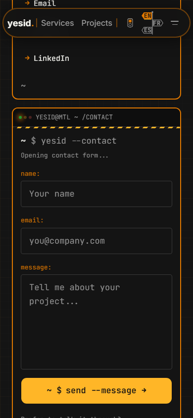
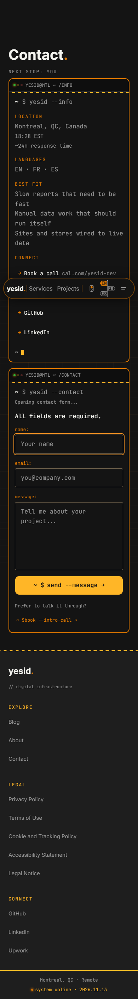
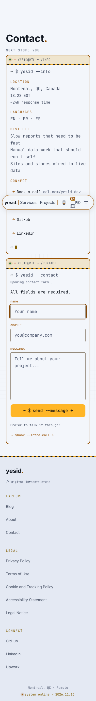

# DEV-2 contact repair handoff

Plan: brand PLAN section 4.1, DEV-2. Evidence: merged yesid-dev section 8.9 and section 10; contact text-en.txt, text-fr.txt, text-es.txt and contact-errors-empty-phone.png (13 November 2026).

## Directus publication required

Owner: the contact page's `block_contact_content` record and its `block_contact_content_translations` rows for en, fr and es. Resolve the record through the contact page block relation; no environment-specific record ID is assumed. Existing fields suffice. Generated content modules were not changed. Today's CMS values continue to render before publication. No CMS writes or production publication were performed.

| Field | English | Français | Español |
| --- | --- | --- | --- |
| form_field_name_label | Name | Nom | Nombre |
| form_field_email_label | Email | Courriel | Correo electrónico |
| form_field_message_label | Message | Message | Mensaje |
| form_field_name_placeholder | Your name | Votre nom | Tu nombre |
| form_field_email_placeholder | name@example.com | nom@exemple.com | nombre@ejemplo.com |
| form_field_message_placeholder | What would you like to build or improve? | Que souhaitez-vous créer ou améliorer? | ¿Qué te gustaría crear o mejorar? |
| form_submit_label | Send message | Envoyer le message | Enviar mensaje |
| booking_prompt | Prefer to talk? | Vous préférez en parler? | ¿Prefieres hablar del proyecto? |
| booking_button_label | Book a call | Réserver un appel | Reservar una llamada |
| success_reset_label | Send another message | Envoyer un autre message | Enviar otro mensaje |
| validation_required | Enter a value for {field}. | Remplissez le champ {field}. | Completa el campo {field}. |
| validation_invalid_email | Enter an email address like name@example.com. | Indiquez une adresse courriel comme nom@exemple.com. | El correo debe tener un formato como nombre@ejemplo.com. |
| validation_error_summary | Check the indicated fields. | Vérifiez les champs indiqués. | Hay campos que corregir. |
| success_sending | Sending your message… | Envoi du message… | Enviando el mensaje… |
| send_error_message | Your message was not sent. Your draft is still here. Try again or email contact@yesid.dev. | Votre message n'a pas été envoyé. Votre brouillon est conservé. Réessayez ou écrivez à contact@yesid.dev. | Tu mensaje no se envió. Tu borrador sigue aquí. Inténtalo de nuevo o escribe a contact@yesid.dev. |
| success_sent | Message sent. Thank you for getting in touch. | Message envoyé. Merci de m'avoir écrit. | Mensaje enviado. Gracias por escribir. |

Required-field guidance and the no-JavaScript explanation are new interface strings in ContactPage.svelte. The email address comes from site_meta.links.email. Field associations, delivery status and validation work with today's CMS text.

Publish these existing fields in Directus with the owner's publication approval, refresh the fixture through the normal export workflow, then verify the live export and deployed page in EN, FR and ES. The localized actions remain outstanding until that publication. Reply-time wording, main-action hierarchy, terminal framing, weather and two-column composition belong to DEV-9.

## Announcement design

One persistent page-level status region announces sending and confirmed success. The duplicated responsive form snippets contain no live regions. Validation and delivery failures focus the submitting form's summary without a second live announcement. Summary links focus the relevant field; inline errors remain associated through aria-describedby and aria-invalid. Browser constraint validation is disabled so malformed email uses that same path. Actual spoken output still requires a screen-reader check in the closure journey.

## Local evidence

- `bun run check`: zero errors and zero warnings.
- Contact component suite: 42 passed. Focus regression failed on the original source, then passed after the repair.
- `bun run build`: passed, including SSR runtime, page contracts and sitemap coverage.
- Full `bun run test`: shared and CMS gates passed; web 1,705 passed and two timed out in `src/lib/og/card.test.ts` adversarial share-card rendering. This unrelated gate remains unresolved; no timeout or test policy was changed.
- New Playwright cases passed for EN, FR and ES at 390 and 1440, dark/light field contrast and outline, and disabled-JavaScript direct email. Live-region mutation assertions verify one sending and one success update for the request. All external requests are blocked in these new cases.
- Existing desktop contact regression suite: 11 passed. Existing phone keyboard journeys: three passed.
- Human screen-reader spoken-output verification remains outstanding. DOM/live-region and keyboard evidence does not establish speech behavior for every AT/browser combination.

